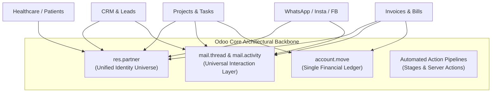
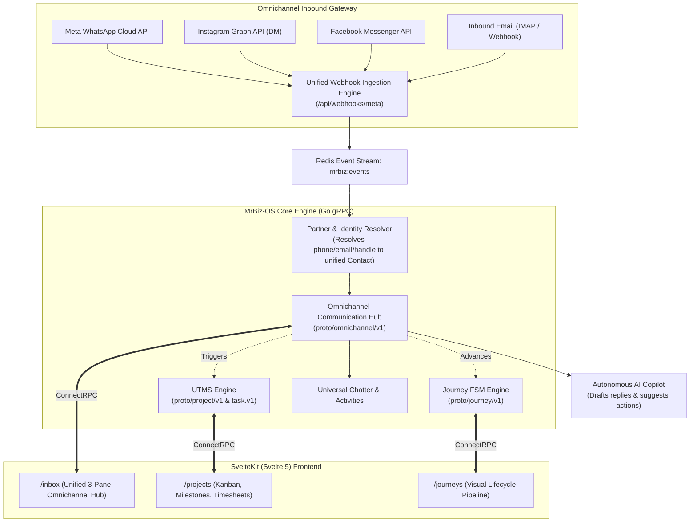

# Odoo Cross-Business Architecture Audit & Master Implementation Plan

## Executive Overview
The objective is to analyze **how Odoo connects every business process into a single unified operating system**, audit what MrBiz-OS currently possesses, and formulate a comprehensive master plan to deliver a superior, AI-powered, low-cost replacement encompassing:
1. **Project Management** (Milestones, Kanban, Timesheets, Cost Tracking)
2. **UTMS (Unified Task Management System)** (Cross-department delegations, SLAs, auto-escalations)
3. **Journey Management** (Patient / Traveler / Real Estate Buyer / Consulting Client lifecycle state machine)
4. **Omnichannel Social & Communication Hub** (Two-way Email, WhatsApp, Instagram DM, Facebook Messenger, Livechat)

---

## 1. Deep Dive: How Odoo Interconnects Everything

Odoo's reputation as an all-in-one ERP rests on **four architectural pillars** that allow every module (Sales, Accounting, Inventory, CRM, Project, HR) to seamlessly talk to one another:

### Pillar 1: The Unified Partner Universe (`res.partner`)
- In Odoo, **every human or organization is a `res.partner`**.
- Whether someone enters as an **Instagram DM**, a **WhatsApp lead**, a **consulting client**, a **hospital patient**, a **real estate buyer**, or a **vendor**, they are assigned a single `res.partner` ID.
- When an email or WhatsApp arrives, Odoo searches by phone/email and attaches it to the existing partner. All prior invoices, active tasks, site visits, and journey stages immediately populate on screen.

### Pillar 2: Universal Chatter (`mail.thread` & `mail.activity`)
- In Odoo, virtually every model inherits from `mail.thread`.
- This attaches a universal **Chatter Panel** to every record:
  - **Omnichannel Logging:** Inbound/outbound emails, WhatsApp chats, SMS, and portal messages are threaded onto that specific record.
  - **Internal Team Notes:** `@mentions` notify team members via internal push notifications without leaving the document.
  - **Scheduled Activities (`mail.activity`):** Standardized next actions ("Call patient in 3 days", "Send quotation follow-up", "Verify KYC") with calendar integration and overdue red badges.

### Pillar 3: Cross-Module Relational Flow
- A Quotation becomes a Sales Order, which automatically:
  1. Creates an analytic **Project** with predefined **Tasks**.
  2. Reserves stock in **Inventory**.
  3. Prepares an **Invoice** in draft state.
  4. Triggers a **Customer Journey** milestone.

### Odoo's Flaws vs. MrBiz-OS Advantage
| Factor | Odoo Enterprise | MrBiz-OS Advantage |
| :--- | :--- | :--- |
| **Runtime Efficiency** | Python GIL, PostgreSQL heavy ORM, 4GB–16GB RAM | **Go binary (< 50MB RAM)**, runs on ₹11k/yr low-resource VPS |
| **API Architecture** | XML-RPC / JSON-RPC (slow, legacy) | **100% gRPC & ConnectRPC** (binary HTTP/2, sub-millisecond) |
| **Social Media Integration** | Expensive 3rd party modules ($500+/yr per channel) | **Native Meta Graph API (WhatsApp + IG + FB) & IMAP/SMTP** |
| **Frontend Speed** | Server-rendered OWL framework (reload lag) | **SvelteKit (Svelte 5 Runes)**, instant sub-10ms UI renders |
| **Automation** | Passive cron jobs & rules | **Autonomous AI Workers** listening to live Redis event streams |

---

## 2. MrBiz-OS Current State Audit

Let's assess what already exists in our codebase and where the gaps lie:

| Capability | Current MrBiz-OS Codebase Status | Missing / Needs Upgrade |
| :--- | :--- | :--- |
| **Journey Management** | ✅ Models exist in `backend/internal/domain/journey/model.go` (`JourneyTemplate`, `JourneyStage`, `JourneyInstance`, `JourneyLog`). | ⚠️ Needs gRPC Proto contract, automated stage transition triggers, and interactive Svelte 5 pipeline UI. |
| **Task Management** | ✅ Models exist in `backend/internal/domain/task/model.go` with `EntityResource`, `EntityID`, `Priority`, `Status`. | ⚠️ Needs full **UTMS** (cross-BU task delegation, SLA countdown timers, recurring tasks, automated escalation). |
| **Project Management** | ⚠️ Only lightweight consulting tasks exist. | ❌ Missing dedicated `Project`, `Milestone`, `Timesheet`, and `Budget/Cost` tracking. |
| **WhatsApp Integration** | ✅ High-quality Meta Cloud API client exists in `backend/internal/services/notification/whatsapp.go` with webhook parser. | ⚠️ Needs 2-way conversation storage, template catalogue UI, and routing into a unified inbox. |
| **Instagram DM & FB** | ❌ None | ❌ Missing Meta Graph Webhooks for Instagram Direct & Facebook Messenger. |
| **Email Integration** | ✅ SMTP sending with templates exists in `backend/internal/services/email/`. | ⚠️ Missing inbound 2-way IMAP/Webhook email parsing and auto-threading to customer profiles. |
| **Unified Omnichannel Inbox** | ⚠️ Consultation chat rooms exist in `backend/internal/domain/communication/model.go`. | ❌ Missing unified Svelte 5 multi-channel inbox merging Email, WhatsApp, Instagram, and FB into one single screen. |

---

## 3. The Master Target Architecture

---

## 4. Detailed Implementation Blueprint

### Phase 1: Unified Identity & Universal Chatter Protocol
1. **Unified Partner/Contact Schema**:
   - `Contact` model supporting: `phone_e164`, `email`, `whatsapp_id`, `instagram_handle`, `facebook_psid`, `business_unit_id`, `tags`.
2. **Chatter & Activities Proto (`proto/common/v1/chatter.proto`)**:
   - `AddNote`: Internal team note with `@mentions`.
   - `ScheduleActivity`: Next action (call, email, meeting, review) with due date and owner.
   - `ListActivities`: Aggregated feed for any entity (`invoice`, `po`, `project`, `patient`, `journey`).

### Phase 2: Project Management & UTMS (Unified Task Management System)
1. **Proto Definition (`proto/project/v1/project.proto`)**:
   - `Project`: Title, code, business unit, client contact ID, budget, billing type (Fixed, Time & Materials), start/end dates.
   - `Milestone`: Deliverable date, invoice trigger amount, status.
   - `Task`: Assignee, priority, status (Kanban column), estimated hours, logged hours, SLA deadline, parent project ID, journey stage ID.
   - `Timesheet`: Logged hours per employee with billable flag.
2. **UTMS Advanced Features**:
   - **Cross-BU Task Routing:** E.g., Healthcare clinical triage assigning a medicine dispatch task to Central Pharmacy; Travel visa team delegating forex payment verification to Finance.
   - **SLA Engine:** Automated escalation when a high-priority task is pending past target hours.

### Phase 3: Journey Management Engine
1. **Proto Definition (`proto/journey/v1/journey.proto`)**:
   - `JourneyTemplate`: Customizable per Business Unit:
     - **Healthcare:** Intake $\to$ Doctor Consultation $\to$ Diagnostic Tests $\to$ Treatment/Rx $\to$ Discharge $\to$ Follow-up.
     - **Travel:** Lead $\to$ Itinerary Consultation $\to$ Visa Doc Collection $\to$ Embassy Submission $\to$ Flight/Hotel Booking $\to$ Travel Departure.
     - **Real Estate:** Property Inquiry $\to$ Qualification $\to$ Site Visit $\to$ Negotiation $\to$ Sale Agreement $\to$ Registry $\to$ Handover.
     - **Software Consulting:** Discovery $\to$ Proposal/SOW $\to$ Sprint Delivery $\to$ UAT $\to$ Handover $\to$ Annual Maintenance.
   - **Automated Stage Hooks:** When a journey enters a new stage:
     - Auto-send WhatsApp/Email confirmation template.
     - Auto-create UTMS tasks for designated team members.
     - Auto-generate milestone invoice in draft status.

### Phase 4: Omnichannel Social & Communication Hub
1. **Inbound Meta Webhook Router (`backend/internal/handlers/meta_webhook.go`)**:
   - Single endpoint verifying Meta webhook signatures (`X-Hub-Signature-256`).
   - Normalizes inbound messages from:
     - **WhatsApp Cloud API** (`messages` webhook)
     - **Instagram Graph API** (`messaging` webhook for Instagram Direct)
     - **Facebook Page Webhook** (`messages` webhook for Page Messenger)
2. **Inbound Email Ingestion**:
   - IMAP poll daemon or SendGrid/Mailgun webhook converter converting incoming customer emails into conversation threads.
3. **Omnichannel gRPC Service (`proto/omnichannel/v1/omnichannel.proto`)**:
   - `ListConversations`: Filter by channel (WhatsApp, Instagram, FB, Email), status (Open, Pending, Resolved), assignee.
   - `GetConversationThread`: Chronological message history with attachments.
   - `SendMessage`: Unified outbound dispatching to the customer's native channel (WhatsApp template/session message, Instagram DM, FB Messenger, or Email).
   - `ConvertConversation`: 1-Click convert chat into a **Lead**, **Project Task**, or **Support Ticket**.

### Phase 5: SvelteKit (Svelte 5) Frontend Modules
1. **Unified Omnichannel Inbox (`/inbox`)**:
   - **Left Pane:** Unified conversation list with channel badges (🟢 WhatsApp, 🟣 Instagram, 🔵 Facebook, 📧 Email), unread counts, and SLA timers.
   - **Center Pane:** Real-time chat feed with rich text, attachments, quick-reply templates, and AI response suggestions.
   - **Right Pane:** Customer 360 profile displaying active Journeys, open Invoices, pending UTMS tasks, and past purchase history.
2. **Project & UTMS Workbench (`/projects`)**:
   - Interactive Kanban board with drag-and-drop column transitions.
   - Gantt chart view for milestones and dependencies.
   - Timesheet logger for consulting and operations staff.
3. **Journey Visualizer (`/journeys`)**:
   - Interactive horizontal progress pipeline showing active customer journeys.
   - Stage gate checklist verification before advancing stages.

### Phase 6: Autonomous AI Copilot Integration
1. **Intelligent Triage & Auto-Drafting**:
   - When an incoming message arrives via WhatsApp, Instagram, or Email, the AI worker retrieves relevant context (product stock, doctor availability, visa rules, invoice status) and drafts a contextual reply.
2. **Human-in-the-Loop Safeguard**:
   - The AI proposal appears in SvelteKit as a suggested draft with a **1-Click "Send"** or **"Edit"** button, preventing unvetted automated hallucinations.

---

## 5. Execution Roadmap & Priority Order

| Step | Action Item | Deliverables |
| :---: | :--- | :--- |
| **1** | **Protobuf Contracts** | Create `proto/project/v1/project.proto`, `proto/journey/v1/journey.proto`, and `proto/omnichannel/v1/omnichannel.proto`. Generate Go stubs via `buf`. |
| **2** | **Project & UTMS Backend** | Implement `backend/internal/grpcservices/project/` connecting to GORM tables (`projects`, `tasks`, `timesheets`, `milestones`). |
| **3** | **Journey Engine Backend** | Implement `backend/internal/grpcservices/journey/` linking existing journey tables with automated stage trigger hooks. |
| **4** | **Meta Unified Webhook & Omnichannel Service** | Unify WhatsApp, Instagram, and FB Messenger webhook ingestion in Go, saving messages to `omnichannel_messages`. |
| **5** | **Svelte 5 Frontend Pages** | Build `/inbox` (Omnichannel 3-Pane Inbox), `/projects` (Kanban/UTMS), and `/journeys` (Pipeline view). |
| **6** | **AI Autonomous Reply Assistant** | Wire `ai-workers/worker.py` to auto-draft responses for incoming social media messages. |
