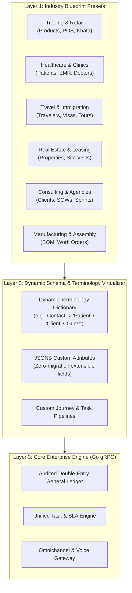
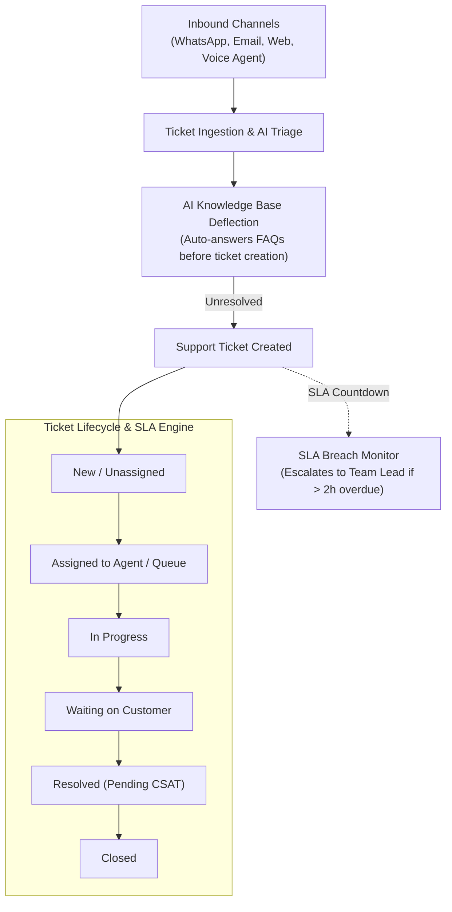
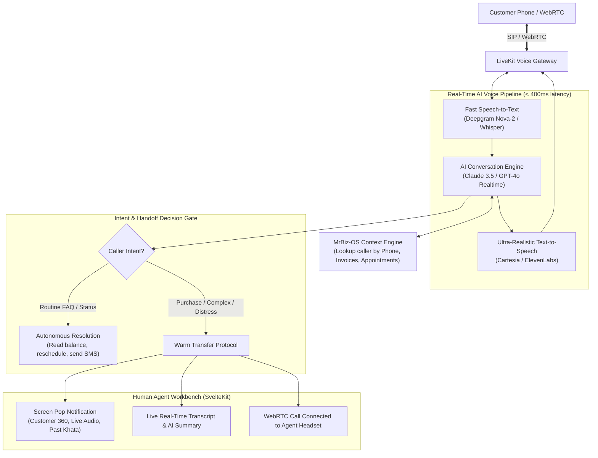
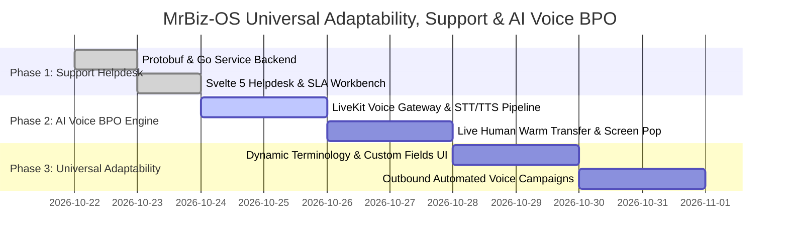

# Master Plan: Universal Business Adaptability, Enterprise Support & AI Voice Agent BPO

## Executive Summary
This master plan specifies the architecture to enable **any industry or business model** (Retail, Healthcare, Travel, Real Estate, Manufacturing, Professional Services, Education, Hospitality) to run on MrBiz-OS, and integrates:
1. **Universal Business Adaptability Engine** (Dynamic industry blueprints, terminology aliases, and custom fields).
2. **Enterprise Support Management System** (Omnichannel helpdesk, multi-tier SLAs, knowledge base deflection, ticket lifecycles).
3. **Autonomous AI Voice Agent BPO & Live Human Handoff** (Inbound & Outbound WebRTC/SIP voice bots with real-time warm transfer to sales reps and specialists).

---

## 1. Universal Business Adaptability: Running "Any Kind of Business"

To replace SAP, Odoo, and Zoho across diverse industries without rewriting code, MrBiz-OS utilizes a **3-Layer Dynamic Business Adapter Engine**:



### A. Preconfigured Industry Blueprint Profiles
Each tenant activates an industry blueprint on signup, which automatically configures modules, default charts of accounts, and workflows:

| Industry Blueprint | Primary Entity Alias | Default Core Workflows | Preloaded Modules |
| :--- | :--- | :--- | :--- |
| **Retail & Wholesale** | `Customer` / `Vendor` | POS, Khata Ledger, Barcode Billing, Supplier POs | Billing, Inventory, POS, Procurement |
| **Healthcare & Clinics** | `Patient` / `Doctor` | Clinical EMR, Telehealth, Lab Requisitions, Pharmacy Rx | Healthcare, EMR, Invoicing, BPO Voice |
| **Travel & Immigration** | `Traveler` / `Visa Applicant` | Visa Document Checklist, VFS Slot Tracking, Tour Packages | Travel OS, Invoicing, Omnichannel |
| **Real Estate & Facilities** | `Buyer` / `Tenant` | Property Inventory, Site Visits, Lease Deeds, Escrow | Real Estate, Accounting, Contracts |
| **Agencies & Consulting** | `Client` / `Consultant` | SOWs, Milestones, Timesheets, Sprint Backlogs | Projects, UTMS, Invoicing, Timesheets |
| **Manufacturing & Assembly**| `Account` / `Supplier` | Bill of Materials (BOM), Work Orders, Raw Stock Reorder | Procurement, Inventory, Accounting |
| **Education & Coaching** | `Student` / `Tutor` | Course Enrollment, Batch Schedules, Fee Invoicing | Projects, Journey, Billing, Support |
| **Hospitality & Dining** | `Guest` / `Host` | Room/Table Reservation, Folio Billing, Kitchen Tickets | POS, Inventory, Omnichannel |

### B. Dynamic Terminology & Custom Fields Engine
- **No Hardcoded Labels:** SvelteKit translates labels based on tenant config (`tenant.terminology.contact_label`, `tenant.terminology.order_label`).
- **JSONB Extensibility:** All core tables (`contacts`, `invoices`, `tasks`, `journeys`) contain a `custom_attributes` JSONB column with schema validation, allowing businesses to add custom fields (e.g. `blood_group` for clinics, `passport_number` for travel, `plot_size` for real estate) via no-code UI.

---

## 2. Enterprise Support Management System (Helpdesk & Ticketing)

The Support Management System consolidates customer issues from **all channels** (WhatsApp, Email, Instagram, Facebook, Phone Voice, Web Portal) into a high-efficiency resolution engine.



### Core Capabilities:
1. **Omnichannel Ingestion:** Automatically converts inbound emails (`support@company.com`), WhatsApp inquiries, social DMs, and voice call transcripts into structured tickets.
2. **AI Knowledge Base Deflection:** Before creating a ticket, AI matches the issue against tenant FAQs/documentation and suggests solutions, deflecting ~40% of routine inquiries.
3. **Configurable SLA Policies:**
   - First Response Time (e.g., Urgent: 15 mins, High: 1 hr, Normal: 4 hrs).
   - Full Resolution Time (e.g., Urgent: 4 hrs, High: 24 hrs, Normal: 48 hrs).
   - Dynamic business hours calendar (excluding weekends and regional holidays).
4. **Multi-Tier Escalation Matrix:** Automatically reassigns tickets and alerts managers if SLA thresholds are breached.
5. **CSAT Feedback:** Automated WhatsApp/Email survey upon ticket resolution (1–5 Stars + comments) updating agent performance telemetry.

---

## 3. Autonomous AI Voice Agent BPO & Live Human Handoff

The AI Voice Agent acts as a **full 24/7 autonomous call center agent** running on WebRTC and SIP. It handles both inbound customer calls and outbound proactive campaigns, with seamless warm transfer to sales reps or specialists.



### A. How Inbound AI Voice Triage Works:
1. **Instant Caller Recognition:** Customer calls in; the phone number is queried against the unified `Contact` database within 50ms.
   - *Example:* "Hello Rajesh! Thank you for calling Apollo Healthcare. I see you had a consultation with Dr. Ayya yesterday. Are you calling regarding your prescription refill, or do you need something else?"
2. **Autonomous Domain Skills:**
   - **Order / Invoice Status:** Looks up payment balances and delivery tracking.
   - **Appointment Booking:** Checks doctor/specialist calendar slots and locks bookings.
   - **Support Ticket Filing:** Records complaints and issues ticket IDs via SMS/WhatsApp.
3. **Ultra-Low Latency Voice Loop (< 400ms):**
   - Uses WebRTC via LiveKit server.
   - Streaming STT (Deepgram Nova-2) $\to$ Tool-calling LLM $\to$ Streaming TTS (Cartesia Sonic).

### B. Intelligent Call Routing & Live Human Handoff ("Warm Transfer"):
When the customer asks to speak with a human or expresses high purchase intent:
1. **Intent & Department Detection:**
   - *"I want to negotiate the price for the Guindy office space"* $\to$ Routes to **Real Estate Sales Desk**.
   - *"I have chest pain after taking the medicine"* $\to$ Routes to **Emergency Clinical Triage**.
   - *"My international shipment is held at customs"* $\to$ Routes to **Logistics Operations Lead**.
2. **The "Screen Pop" Protocol:**
   - Before connecting the audio to the human agent, the agent’s SvelteKit browser displays an incoming call banner with:
     - Customer name, company, and lifetime value.
     - **3-Bullet AI Summary:** What the customer asked and what the bot already answered.
     - **Live Transcript:** Full text of the call so the agent never asks the customer to repeat themselves.
3. **Seamless Audio Bridge:**
   - The bot announces to the customer: *"I'm transferring you directly to Divya from our real estate team, who has your property details on her screen right now."*
   - Audio is bridged via LiveKit room transfer with zero dropped packets.

### C. Outbound AI Voice Campaigns:
- **Overdue Invoices (Dunning):** Friendly autonomous payment reminder calls offering instant WhatsApp payment links.
- **Appointment Reminders:** Automated confirmation calls with 1-click voice rescheduling.
- **Inbound Lead Fast Callback:** Automatically calls web prospects within 30 seconds of form submission to qualify leads.

---

## 4. Protobuf Contracts Definition

### A. Support & Helpdesk Service (`proto/support/v1/support.proto`)
```protobuf
syntax = "proto3";
package support.v1;
option go_package = "drayya-core/gen/support/v1;supportv1";

service SupportService {
  rpc ListTickets(ListTicketsRequest) returns (ListTicketsResponse);
  rpc CreateTicket(CreateTicketRequest) returns (CreateTicketResponse);
  rpc GetTicketDetails(GetTicketDetailsRequest) returns (GetTicketDetailsResponse);
  rpc ReplyTicket(ReplyTicketRequest) returns (ReplyTicketResponse);
  rpc UpdateTicketStatus(UpdateTicketStatusRequest) returns (UpdateTicketStatusResponse);
  rpc AssignTicket(AssignTicketRequest) returns (AssignTicketResponse);
  rpc SubmitCSAT(SubmitCSATRequest) returns (SubmitCSATResponse);
}

message TicketItem {
  string id = 1;
  string ticket_number = 2; // e.g. TIK-2026-0891
  string customer_name = 3;
  string customer_contact = 4;
  string subject = 5;
  string category = 6; // BILLING, TECHNICAL, MEDICAL, LOGISTICS, GENERAL
  string priority = 7; // LOW, NORMAL, HIGH, URGENT
  string status = 8; // NEW, ASSIGNED, IN_PROGRESS, WAITING_CUSTOMER, RESOLVED, CLOSED
  string channel = 9; // WHATSAPP, EMAIL, VOICE_BOT, PORTAL, SOCIAL
  string assigned_to = 10;
  string business_unit = 11;
  int32 sla_minutes_remaining = 12;
  bool is_sla_breached = 13;
  string created_at = 14;
}
```

### B. BPO AI Voice Call Center Service (`proto/bpo/v1/voice.proto`)
```protobuf
syntax = "proto3";
package bpo.v1;
option go_package = "drayya-core/gen/bpo/v1;bpov1";

service VoiceBPOService {
  rpc StartInboundCallSession(StartCallRequest) returns (StartCallResponse);
  rpc ProcessVoiceTurn(VoiceTurnRequest) returns (VoiceTurnResponse);
  rpc RequestHumanHandoff(HandoffRequest) returns (HandoffResponse);
  rpc ListActiveCalls(ListCallsRequest) returns (ListCallsResponse);
  rpc LaunchOutboundCampaign(LaunchCampaignRequest) returns (LaunchCampaignResponse);
}

message CallSession {
  string call_id = 1;
  string caller_phone = 2;
  string customer_name = 3;
  string status = 4; // AI_HANDLING, QUEUED_FOR_AGENT, IN_CALL_WITH_AGENT, COMPLETED
  string intent = 5; // SALES_INQUIRY, BILLING_DISPUTE, SUPPORT_COMPLAINT, MEDICAL_TRIAGE
  string assigned_agent = 6;
  string livekit_room_token = 7;
  string live_transcript = 8;
  string ai_summary = 9;
  int32 call_duration_seconds = 10;
}
```

---

## 5. Phased Implementation Roadmap



| Phase | Milestone | Deliverables |
| :---: | :--- | :--- |
| **Phase 1** | **Enterprise Support Management** | `proto/support/v1/support.proto`, Go gRPC handler, Svelte 5 `/support` ticketing workbench with SLA countdown and canned replies. |
| **Phase 2** | **AI Voice Agent & Human Handoff** | `proto/bpo/v1/voice.proto`, LiveKit WebRTC audio pipeline, intent classifier, live warm-transfer "Screen Pop" in SvelteKit. |
| **Phase 3** | **Universal Business Customizer** | Multi-industry preset selector, custom fields editor, dynamic terminology aliases. |
| **Phase 4** | **Outbound Voice Campaign Engine** | Autonomous payment collection calls, appointment verification, and instant web-lead callbacks. |
