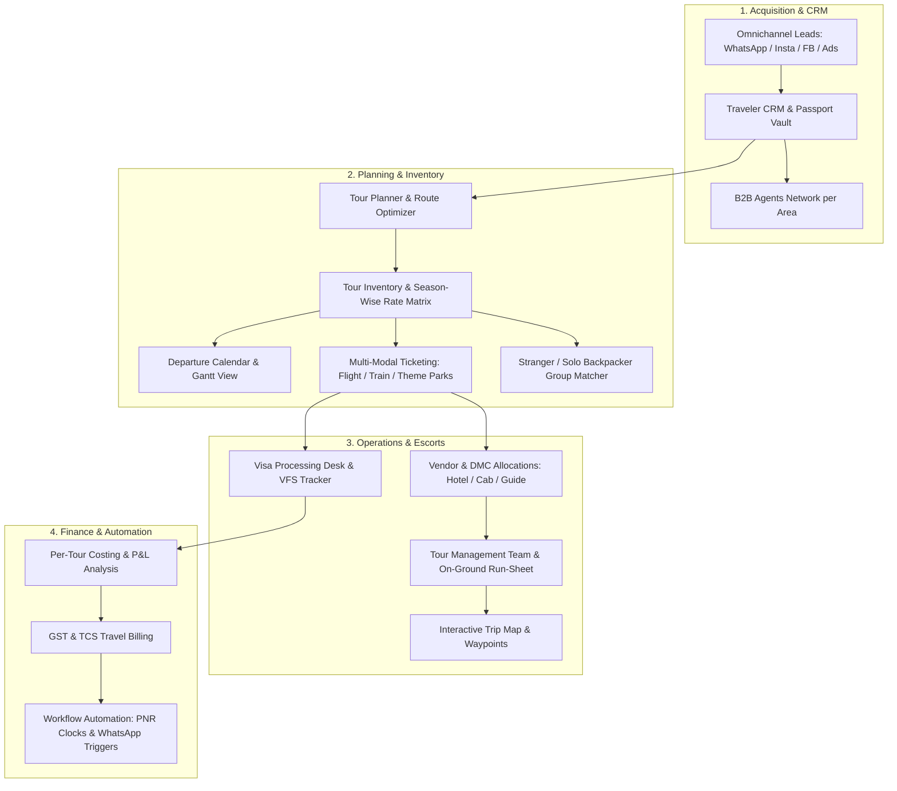

# MRBiz OS — Tour & Travel Enterprise Suite Plan
## Comprehensive Architecture & Implementation Roadmap for 19 Sub-Modules

---

## 1. Executive Vision

Transform the MRBiz OS **Tour & Travel Module** from a standalone package/visa view into an **End-to-End Enterprise Travel Operating System (TravelOS)**. 

Travel businesses (Inbound/Outbound Tour Operators, DMCs, B2B Wholesalers, and Retail Travel Agencies) require a unified platform where an inquiry captured from WhatsApp or Instagram seamlessly flows through AI itinerary building, airline/train ticket holding, visa processing, vendor voucher issuance, per-tour P&L accounting, on-ground tour escort management, and post-tour customer khata settlement.



---

## 2. The 19 Specialized Sub-Modules Breakdown

### Sub-Module 1: Traveler CRM & Passenger Vault
* **Purpose**: Single source of truth for travelers, corporate clients, and guest profiles.
* **Key Capabilities**:
  * **Digital Passport Vault**: Encrypted passport copy storage, expiry date countdown alerts (flags passports with < 6 months validity).
  * **Traveler Preferences**: Meal requirements (Pure Veg, Jain, Halal, Diabetic), seating preference (Aisle/Window), frequent flyer numbers (Star Alliance, SkyTeam, OneWorld).
  * **Family & Group Linking**: Link primary bookers with co-travelers and infants.
  * **VIP & Khata History**: Lifetime value (LTV), previous trips, loyalty tier, outstanding balances.

### Sub-Module 2: Travel Workflow Automation Engine
* **Purpose**: Eliminate manual operational errors through event-driven automated actions.
* **Key Capabilities**:
  * **Airline PNR Hold Clock**: Auto-countdown timers with automated alerts to clients 12h and 2h before fare-lock expiry.
  * **Payment Milestones**: Automatic WhatsApp/SMS payment reminders for advance (30%), pre-visa (50%), and pre-departure balance (100%).
  * **Voucher Dispatch**: Instant release of hotel, transport, and flight e-vouchers once full payment is reconciled.
  * **Web Check-In Triggers**: Automated tasks generated 24h before flight departure for the ticketing desk.

### Sub-Module 3: Inventory of Tours & Seat Blocks
* **Purpose**: Manage capacity, room blocks, and group departure quotas.
* **Key Capabilities**:
  * **Trip Types**: Fixed Group Departures (GIT), Customized Private Tours (FIT), Weekend Treks, and MICE Corporate Charters.
  * **Capacity Ledger**: Real-time seat inventory (Total: 40, Booked: 28, Held: 4, Available: 8).
  * **Waitlist Engine**: Auto-queue travelers if departures are fully sold; auto-promotes if cancellations occur.
  * **Block Booking Allocations**: Manage flight seat blocks with airlines and room allotments with hotel chains.

### Sub-Module 4: Vendors & DMC Management
* **Purpose**: Contract management and payables tracking for suppliers worldwide.
* **Key Capabilities**:
  * **Vendor Classification**: Destination Management Companies (DMCs), Luxury/Budget Hotels, Coach/Cab Fleet Providers, Local Certified Guides, Cruise Lines, and Visa Agents.
  * **Vendor Rate Cards**: Contracted seasonal B2B rates with child/extra-bed policies.
  * **Voucher Generator**: Standardized service confirmation vouchers with QR validation for hotel check-ins.
  * **Vendor Khata & Payables**: Track credit terms, advance deposits to overseas DMCs, and payable aging.

### Sub-Module 5: Tour Management Team & Escort Dispatch
* **Purpose**: Operational run-sheet and communication for on-ground tour leaders.
* **Key Capabilities**:
  * **Tour Leader Assignment**: Roster certified tour managers, tour guides, and local coach captains.
  * **Daily Operational Run-Sheet**: Minute-by-minute itinerary schedule, driver contact, hotel reception manager, emergency hospital locator.
  * **Passenger Manifest & Rooming List**: Real-time passenger list with room number mappings (Twin/Double/Single).
  * **Incident & SOS Management**: Medical emergencies, passport loss protocol, flight delay diversion tracking.

### Sub-Module 6: Visa Processing Team & VFS Desk
* **Purpose**: Zero-error visa document handling and embassy appointment scheduling.
* **Key Capabilities**:
  * **Country Visa Rules Database**: Schengen, UK, US B1/B2, UAE 30/60 days, Singapore, Thailand e-Visa requirements.
  * **Digital Document Checklist**: Tracks passport, bank statements (6 months stamped), ITR-V, NOC, flight hold tickets, hotel reservations.
  * **Appointment Tracking**: VFS Global / BLS / US TravelDocs slot dates, biometric status, and passport dispatch tracking number.
  * **Visa Issuance Archive**: PDF copies linked directly to traveler CRM profiles.

### Sub-Module 7: Per-Tour Costing & Accounts
* **Purpose**: Deep financial profitability tracking for every departure.
* **Key Capabilities**:
  * **Departure P&L**: Direct revenue vs. Flights + Hotels + Transport + Guide + Visas + TCS = Net Margin & Profit per Pax.
  * **Multi-Currency & Forex**: Record costs in USD, EUR, AED, THB with automatic exchange rate conversion to INR and currency fluctuation protection buffers.
  * **TCS Compliance (Indian LRS)**: Automatic calculation of 5% (up to ₹7 Lakhs) or 20% (above ₹7 Lakhs) Tax Collected at Source on foreign tour packages.

### Sub-Module 8: GST Travel Billing & Invoicing
* **Purpose**: Compliant billing with specialized travel industry tax treatments.
* **Key Capabilities**:
  * **SAC 9985 Compliant Invoicing**: 5% GST without ITC for tour operators or 18% with ITC for transport/standalone booking services.
  * **Booking Proforma & Quotations**: Clean proforma invoices with detailed breakdown of inclusions/exclusions.
  * **Split Invoicing**: Option to bill corporate MICE packages split into accommodation, airfare, and service fees.
  * **Instant UPI / Payment Gateways**: Dynamic UPI QR codes and Razorpay/Stripe payment links embedded on invoices.

### Sub-Module 9: Omnichannel Lead Management
* **Purpose**: Ingest and nurture travel leads from every digital touchpoint.
* **Key Capabilities**:
  * **Channel Integrations**: WhatsApp Business, Instagram DMs, Facebook Lead Ads, Google Ads Webhook, Website Inquiry Forms.
  * **Lead Enrichment**: Auto-tag destination interest (e.g. *#EuropeSummer2026*, *#KashmirHoneymoon*), budget range, tentative dates, and pax count.
  * **Visual Sales Pipeline**: Kanban stages: *New Lead → Requirements Collected → Itinerary Sent → Negotiation → Booked → Post-Tour*.
  * **Lead Response SLA**: Speed-to-lead monitoring with automated first-response travel brochures.

### Sub-Module 10: Tour Organizer & Drag-and-Drop Itinerary Builder
* **Purpose**: Create stunning, day-by-day travel itineraries in minutes.
* **Key Capabilities**:
  * **Visual Day Blocks**: Day 1 Arrival & Marina Dhow Cruise, Day 2 Desert Safari with BBQ Dinner, etc.
  * **Activity Sequencing**: Morning, Afternoon, Evening time-slots with sightseeing photos and descriptions.
  * **Meal & Transfer Flags**: Clear tags for Breakfast, Lunch, Dinner, Private AC Coach, English-speaking guide.
  * **Branded PDF Export**: 1-click export to a luxury, magazine-grade PDF quotation with agency logo, inclusions, and terms.

### Sub-Module 11: B2B Agents List per Area & Wholesaling
* **Purpose**: Empower regional travel agents and sub-brokers with commission tracking.
* **Key Capabilities**:
  * **Geographical Directory**: Search travel agents filtered by State, City, District, or Pincode.
  * **Commission Slabs**: Tiered commission engine (e.g. Bronze 8%, Silver 10%, Gold 12%).
  * **Credit Limits**: Set agent credit balances with automated blocking on payment default.
  * **White-Label Vouchers**: Option for B2B agents to download itineraries with their own agency branding.

### Sub-Module 12: Smart Tour Planning & Route Optimization
* **Purpose**: Determine the most cost-effective, time-efficient travel circuits.
* **Key Capabilities**:
  * **Multi-City Route Planner**: Optimal sequencing (e.g. *Fly in: Paris → TGV Train: Geneva → Scenic Train: Interlaken → Fly out: Zurich*).
  * **Transit Duration Calculator**: Calculates realistic road/train travel times between sightseeing points to prevent tourist fatigue.
  * **Layover Minimizer**: Highlights routes with direct flights or minimal airport transit time.

### Sub-Module 13: Season-Wise Tour Pricing & Rate Cards
* **Purpose**: Dynamic pricing adjusted for peak holiday periods and weather seasons.
* **Key Capabilities**:
  * **Seasonal Slabs**: Peak Season (Dec-Jan, May-Jun), Shoulder Season (Sep-Nov), Off-Peak / Monsoon Season (Jul-Aug).
  * **Weekend & Festival Surges**: Automatic rate multipliers for Diwali, Christmas, New Year, and Eid.
  * **Early Bird Discounts**: Configurable discount rules for bookings made 90+ days in advance.

### Sub-Module 14: Interactive Tour Calendar & Gantt View
* **Purpose**: High-level visual cockpit of all operational departures.
* **Key Capabilities**:
  * **Departure Gantt Matrix**: Visual timeline showing active, upcoming, and completed group departures.
  * **Occupancy Color Coding**: Green (>80% full), Amber (50-80% full), Red (<50% full - action needed).
  * **Resource Allocation Overlay**: View tour manager, vehicle, and hotel availability on the same timeline.

### Sub-Module 15: Interactive Tour Trip Map & GPS Waypoints
* **Purpose**: Engaging visual route map for sales pitches and traveler orientation.
* **Key Capabilities**:
  * **Interactive Map Canvas**: Leaflet/Mapbox powered vector map showing route markers and driving paths.
  * **Day-by-Day Path Highlights**: Click Day 3 to zoom into the specific city path, hotel location, and tourist attractions.
  * **Distance & Altitude Profile**: Total KM traveled, mountain passes, and scenic highway checkpoints.

### Sub-Module 16: Stranger & Solo Backpacker Trip Organizing
* **Purpose**: Curate, fill, and manage community group trips for solo travelers.
* **Key Capabilities**:
  * **Solo Room-Sharing Matcher**: Algorithmic roommate pairing by gender, age bracket, and sleep habits to avoid single-supplement surcharges.
  * **Pre-Trip Community Icebreaker**: Verified group chat link dispatch 5 days prior to departure.
  * **Curated Themes**: Women-Only Departures, Photography Expeditions, Weekend Hiking Batches, Cultural Backpackers.
  * **Emergency Contact Vault**: Mandatory secondary next-of-kin verification for all solo participants.

### Sub-Module 17: Domestic Circuit Planner (Incredible India)
* **Purpose**: Pre-engineered itineraries tailored for Indian domestic tourism.
* **Key Capabilities**:
  * **Signature Circuits Pre-loaded**:
    * Golden Triangle (Delhi - Agra - Jaipur - Ranthambore)
    * Kerala Backwaters (Cochin - Munnar - Thekkady - Alleppey Houseboat - Kovalam)
    * Kashmir Paradise (Srinagar - Gulmarg - Pahalgam - Sonamarg)
    * Himalayan Odyssey (Leh - Nubra Valley - Pangong Tso)
    * Chardham Yatra (Yamunotri - Gangotri - Kedarnath - Badrinath)
    * Goa Sun & Sand (North & South Goa Heritage)
    * Northeast Jewels (Assam - Meghalaya - Kaziranga)
    * Andaman Island Hopper (Port Blair - Havelock - Neil Island)
  * **Indian State Permit Automation**: ILP (Inner Line Permit) tracking for Ladakh, Sikkim, and Arunachal Pradesh.

### Sub-Module 18: Multi-Modal Ticket Management
* **Purpose**: Centralized issuance, PNR tracking, and voucher storage for all transit types.
* **Key Capabilities**:
  * **Flight PNRs**: Airline, flight number, departure terminal, baggage allowance, web check-in boardings.
  * **Domestic Trains (IRCTC)**: Train number, PNR, Berth/Coach (1A, 2A, 3A, CC, SL), and Tatkal booking reminders.
  * **Theme Park & Attraction Passes**: Instant issuance of barcode tickets for Burj Khalifa, Disneyland, Universal Studios, Ferrari World, Ramoji Film City.
  * **Cruises & Ferries**: Cabin deck category, boarding pass, sea sickness assistance notices.

### Sub-Module 19: Unified 360° Travel Operations Cockpit
* **Purpose**: End-to-end mission control uniting inquiry, booking, dispatch, and review.
* **Key Capabilities**:
  * **Booking Readiness Bar**: 4-point health check (*Flights Ticketed ✓ | Hotels Reconfirmed ✓ | Visas Stamped ✓ | Travel Kit Dispatched ✓*).
  * **Departure Day Screen Pop**: On-duty coordinator view of flights taking off today with passenger status.
  * **Post-Tour Review Collector**: 1-click WhatsApp feedback link dispatch upon trip completion.
  * **Customer Repeat Booking Khata**: Automatically tags happy clients for upcoming seasonal tour launches.

---

## 3. Technical Architecture & Database Schema Additions

### GORM Database Models (PostgreSQL)

```go
// TourPackageModel: Enhanced with seasonal pricing and circuits
type TourPackageModel struct {
    ID              string         `gorm:"primaryKey;type:uuid"`
    TenantID        string         `gorm:"index;not null"`
    Title           string         `gorm:"not null"`
    Destination     string         `gorm:"index;not null"`
    Category        string         `gorm:"index"` // DOMESTIC, INTERNATIONAL, SOLO_STRANGER, MICE
    DurationDays    int            `gorm:"not null"`
    DurationNights  int            `gorm:"not null"`
    BasePriceAdult  float64        `gorm:"not null"`
    BasePriceChild  float64        `gorm:"default:0"`
    SingleSupplement float64       `gorm:"default:0"`
    SeasonalityJSON string         `gorm:"type:text"` // Peak, Shoulder, Off-Peak matrices
    ItineraryJSON   string         `gorm:"type:text"` // Day-by-day rich itinerary
    MapWaypointsJSON string        `gorm:"type:text"` // Lat/Lng waypoints for map rendering
    InclusionsJSON  string         `gorm:"type:text"`
    ExclusionsJSON  string         `gorm:"type:text"`
    IsActive        bool           `gorm:"default:true"`
    CreatedAt       time.Time
    UpdatedAt       time.Time
}

// TourDepartureModel: Real-time inventory and seat blocks
type TourDepartureModel struct {
    ID              string         `gorm:"primaryKey;type:uuid"`
    PackageID       string         `gorm:"index;not null"`
    TenantID        string         `gorm:"index;not null"`
    DepartureDate   time.Time      `gorm:"index;not null"`
    ReturnDate      time.Time      `gorm:"not null"`
    TotalSeats      int            `gorm:"not null"`
    BookedSeats     int            `gorm:"default:0"`
    HeldSeats       int            `gorm:"default:0"`
    TourLeaderID    string         `gorm:"index"`
    Status          string         `gorm:"default:'OPEN'"` // OPEN, FAST_FILLING, SOLD_OUT, DEPARTED
}

// TravelTicketModel: Flight, Train, Attraction, Ferry passes
type TravelTicketModel struct {
    ID              string         `gorm:"primaryKey;type:uuid"`
    BookingID       string         `gorm:"index;not null"`
    TicketType      string         `gorm:"index"` // FLIGHT, TRAIN, THEME_PARK, CRUISE, BUS
    ProviderName    string         `gorm:"not null"`
    PnrOrReference  string         `gorm:"index;not null"`
    TravelDate      time.Time      `gorm:"index"`
    SectorOrDetails string         `gorm:"not null"`
    PassengerName   string         `gorm:"not null"`
    SeatOrBerth     string         
    CostAmount      float64        `gorm:"not null"`
    SaleAmount      float64        `gorm:"not null"`
    Status          string         `gorm:"default:'CONFIRMED'"`
    AttachmentURL   string         
}

// B2BAgentModel: Area-wise travel agents network
type B2BAgentModel struct {
    ID              string         `gorm:"primaryKey;type:uuid"`
    TenantID        string         `gorm:"index;not null"`
    AgencyName      string         `gorm:"not null"`
    ContactPerson   string         `gorm:"not null"`
    Phone           string         `gorm:"index;not null"`
    Email           string         `gorm:"index;not null"`
    State           string         `gorm:"index;not null"`
    City            string         `gorm:"index;not null"`
    AreaPincode     string         `gorm:"index"`
    Tier            string         `gorm:"default:'SILVER'"` // BRONZE, SILVER, GOLD, PLATINUM
    CommissionPct   float64        `gorm:"default:10.0"`
    CreditLimit     float64        `gorm:"default:0"`
    CurrentBalance  float64        `gorm:"default:0"`
    IsActive        bool           `gorm:"default:true"`
}
```

---

## 4. Phased Implementation Roadmap

### Phase 1: High-Priority Operational Core (Immediate)
* Implement unified **Tabbed Travel Hub** in `frontend/src/routes/travel/+page.svelte`:
  1. **Cockpit**: 360° Operations Pipeline & Booking Readiness
  2. **Itinerary Builder & Organizer**: Drag-and-drop Day-by-day creator with PDF exporter
  3. **Multi-Modal Ticketing**: Flight PNRs, IRCTC Train berths, Theme Park passes
  4. **Inventory & Departure Calendar**: Gantt capacity tracking and seat blocks
  5. **Stranger / Solo Trip Organizer**: Roommate matcher and backpacker departures
  6. **Domestic Circuits**: Pre-loaded Incredible India travel packages
  7. **B2B Agents Directory**: Geo-mapped agents list with commission slabs
  8. **Visa Desk & VFS Tracker**: Multi-country checklist & biometric tracker
  9. **Vendors & DMC Desk**: Hotel & transport vouchers + payables
  10. **Per-Tour P&L Costing**: Revenue vs. direct costs + TCS calculation

### Phase 2: Omnichannel Ingestion & Automation (Next Step)
* Connect WhatsApp and Social Lead Ingestion with travel quotation fast-generation.
* Implement airline PNR hold clock auto-alert timers.

### Phase 3: Interactive Maps & Customer Portal
* Leaflet map visualization for itinerary day routes.
* Client-facing digital itinerary URL with mobile responsive view.

---

## 5. Verification & Quality Standards
* **Design Standards**: Fully consistent with MRBiz OS Indigo `#4F46E5`, Inter typography, light default + dark mode, WCAG AA semantic badges.
* **Testing**: Zero TypeScript errors via `npm run check`.
* **Zero Bundling**: Kept as an independent module that only activates when subscribed.
