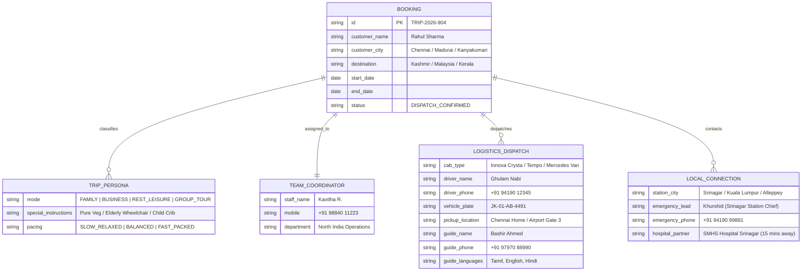

# MRBiz OS — Real-World Tour & Travel Operations Architecture
## Customer-Centric Trip File System, Persona Modes & On-Ground Dispatch Engine

---

## 1. Executive Summary & Core Understanding

We understand your travel agency's core operational reality:
Travel is not just static packages; it is an **orchestration of human logistics tailored to each specific traveler**.

```
[Customer from Chennai, Madurai, or Kanyakumari]
                 │
                 ▼
[Trip Archetype Classification] 
 ├── 👨‍👩‍👧‍👦 Family Tour (Pacing, Kid/Elderly care, Pure Veg/Jain meals)
 ├── 💼 Business / MICE Trip (Punctuality, Airport VIP, Invoicing, Wi-Fi)
 ├── 🌴 Rest & Relaxation Mode (Slow travel, Spa, Private pool villa, No rush)
 └── 👥 Group Departure (Fixed schedule, shared coach, Tour Leader)
                 │
                 ▼
[Assigned Team Coordinator (Operations Desk)]
                 │
                 ▼
[Granular On-Ground Execution Matrix]
 ├── 🚗 Car Pickup & Drop (Exact airport/home transfer)
 ├── 👨‍✈️ Driver Details (Name, Phone, Vehicle No, Cab model)
 ├── 🏨 Hotel & Room Vouchers (Meal plan CP/MAP/AP, early check-in)
 ├── ✈️ All Tickets (Flight PNR, IRCTC train, Theme park passes)
 ├── 🛂 Visa Management (Embassy/VFS slots, biometrics, stamped e-pass)
 ├── 🗣️ Local Certified Guide (Name, Contact, Languages: Tamil/Hindi/English)
 └── 🤝 Local Emergency Station Connection (Ground handler in Srinagar / KL / Munnar)
```

---

## 2. Real-World Case Studies Handled by the System

### Case A: Chennai Customer → Kashmir Trip (4 Days / 5 Nights — Family Mode)
* **Customer**: Rahul & Family (4 Pax: Husband, Wife, 2 Children) from Chennai.
* **Trip Mode**: **`FAMILY_TOUR`** (Comfort, child-friendly stops, vegetarian food).
* **Assigned Team Coordinator**: **Kavitha R.** (Senior North India Ops Officer).
* **On-Ground Coordination**:
  * **Airport Pickup**: Srinagar Airport (SXR) Pickup. Driver waiting at Exit Gate with Name Placard.
  * **Driver & Vehicle**:
    * Driver Name: *Ghulam Nabi*
    * Contact: `+91 94190 12345`
    * Vehicle: *Toyota Innova Crysta (White)*
    * Plate Number: `JK-01-AB-4491`
  * **Hotels & Rooming**:
    * Nights 1 & 2: *Radisson Srinagar* (2 Deluxe Garden Rooms, MAP Plan - Breakfast & Dinner).
    * Night 3: *The Khyber Himalayan Resort & Spa, Gulmarg* (Heated rooms).
    * Night 4: *WelcomHeritage Gurkha Luxury Houseboat, Nigeen Lake* (Sunset Shikara included).
  * **Local Certified Guide**:
    * Guide Name: *Bashir Ahmed* (Govt. Licensed Guide, speaks Hindi, English, understands basic Tamil).
    * Contact: `+91 97970 88990`.
  * **Sightseeing & Passes**:
    * Phase 1 & Phase 2 Gulmarg Gondola Tickets pre-booked (QR codes issued).
  * **Local Ground Connection**: *Srinagar Local Station Desk: Khurshid (+91 94190 99881)* for 24/7 on-ground assistance.

---

### Case B: Madurai Customer → Malaysia Trip (International — Business / Corporate Mode)
* **Customer**: K. Senthil Kumar (Managing Director) + 2 Executives from Madurai.
* **Trip Mode**: **`BUSINESS_MICE`** (Punctuality, fast transit, corporate invoice with GST input tax credit).
* **Assigned Team Coordinator**: **Deepak M.** (International Corporate Desk).
* **On-Ground Coordination**:
  * **Flight Ticketing**: Madurai (IXM) → Chennai (MAA) → Kuala Lumpur (KUL) on Malaysia Airlines (`MH-181`).
  * **Visa Processing**: Malaysia Digital Arrival Card (MDAC) + Single Entry eVisa stamped and issued.
  * **Airport VIP Transfer**: KLIA Airport Meet & Assist at Aerotrain exit gate.
  * **Driver & Vehicle**:
    * Chauffeur: *Mohammad Razak*
    * Contact: `+60 12 345 6789`
    * Vehicle: *Mercedes V-Class Executive Van*
    * Plate Number: `WYY-8921`
  * **Hotel**: *Grand Hyatt Kuala Lumpur* (Club King Rooms with Executive Lounge access & high-speed Wi-Fi).
  * **Local DMC Partner in Malaysia**: *Asian Trails Malaysia (DMC-KUL-4401)*.
  * **Local Connection Contact**: *Grace Lim (+60 3 2141 8800)* for instant local itinerary adjustments.

---

### Case C: Kanyakumari Customer → Kerala Trip (3 Days / 2 Nights — Rest / Leisure Mode)
* **Customer**: Dr. V. Rajesh & Deepa (Honeymoon / Rest & Rejuvenate) from Kanyakumari.
* **Trip Mode**: **`REST_LEISURE`** (Slow travel, late morning starts, no frantic sightseeing, privacy).
* **Assigned Team Coordinator**: **Arjun S.** (South India Leisure Desk).
* **On-Ground Coordination**:
  * **Direct Doorstep Pickup**: Private cab pickup directly from their home in Kanyakumari.
  * **Driver & Vehicle**:
    * Driver: *K. Suresh Kumar* (Polite, experienced hill driver, speaks Tamil & Malayalam).
    * Contact: `+91 98421 77665`
    * Vehicle: *Hyundai Alcazar AC*
    * Plate Number: `TN-74-BC-2022`
  * **Resorts & Stay**:
    * Night 1: *Spice Tree Resort Munnar* (Private Jacuzzi Mountain View Chalet).
    * Night 2: *Lakes & Lagoons Luxury Houseboat, Alleppey* (1-Bedroom Exclusive Cruise, Chef on board).
  * **Experiences**:
    * Ayurvedic Full Body Abhyanga Massage reserved at 5:00 PM.
    * Candlelight lakeside dinner on the houseboat deck.
  * **Local Emergency Connection**: *Kumarakom/Alleppey Station Liaison: Biju (+91 94470 55441)*.

---

## 3. Core Database & Model Enhancements

To give your team complete control over each traveler file, we extend the trip data structure with **On-Ground Dispatch Entities**:



---

## 4. Operational View for Your Team

Your team will have a dedicated **360° Trip File Dispatch Inspector** directly inside the Travel Module:

1. **Trip Mode Selector Badge**:
   - 👨‍👩‍👧‍👦 **Family Mode**: Flags meal allergies, child preferences, family interconnected rooms.
   - 💼 **Business Mode**: Flags GSTIN for corporate invoice, airport VIP lounge passes, express Wi-Fi rooms.
   - 🌴 **Rest & Leisure Mode**: Flags late checkout (2:00 PM), spa appointment times, candlelight dining vouchers.
   - 👥 **Group Tour Mode**: Links passenger to Group Bus Coach #1, Tour Leader name, and morning roll-call checklist.

2. **Driver & Transport Dispatch Card**:
   - 1-Click **WhatsApp Driver Details to Customer**: Sends driver name, live location link, vehicle photo, and license plate number 4 hours before pickup.
   - Driver flight-tracking integration (alerts driver if customer flight is delayed).

3. **Local Guide & Language Matcher**:
   - Matches guides who speak the traveler's native language (e.g. Tamil-speaking guide in Kashmir or Golden Triangle).

4. **Local Station Hub & Emergency Desk**:
   - 24/7 ground contact in destination city.
   - Nearest partner hospital and medical clinic on file.
   - Police station / tourist helpline emergency one-tap dialer.

5. **Customer Digital Live Itinerary Card**:
   - Customer receives a clean, mobile-optimized link on WhatsApp showing:
     * Driver Name & Phone (with tap-to-call)
     * Hotel Check-in Vouchers & Room Numbers
     * Flight & Train E-Tickets with live gate status
     * Day-Wise Program with Google Maps pin for each stop

---

## 5. Next Implementation Step

We will incorporate this **Trip Persona & On-Ground Dispatch Engine** into:
- The **Active Bookings Deck** in [`travel/+page.svelte`](file:///d:/Project%20Files/MrBiz-OS/frontend/src/routes/travel/+page.svelte)
- A new interactive **"On-Ground Logistics & Driver Dispatch Modal"** allowing team coordinators to assign driver details, guide contacts, local station leads, and send WhatsApp confirmation kits to travelers.
