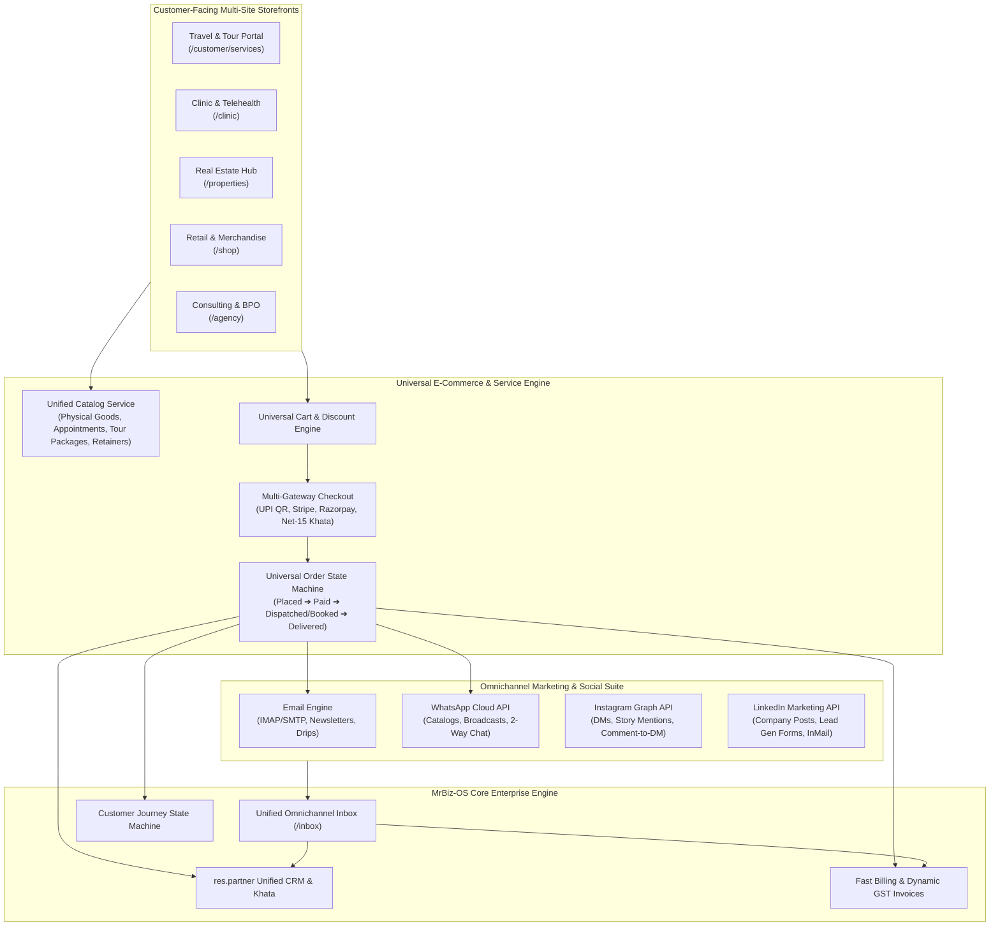

# Multi-Business Website, Universal E-Commerce & Omnichannel Marketing Plan

## Executive Summary

MrBiz-OS operates as a multi-business group platform spanning distinct commercial verticals:
1. **Tour & Travel OS** (`/travel`, `/customer/services`, `/travel/booking`)
2. **Healthcare & Telemedicine OS** (`/healthcare`)
3. **Real Estate & Property OS** (`/realestate`)
4. **Retail POS & Express Billing** (`/pos`, `/billing`)
5. **Software Consulting & SOW Agency** (`/consulting`, `/projects`)
6. **AI Voice Agent BPO Call Center** (`/bpo-voice`)
7. **E-Commerce & Print-on-Demand** (`/ecommerce`)
8. **Export / Import Global Trade OS** (`/trade`)

To maximize revenue and brand equity across all subsidiaries, the group requires a **Unified Multi-Business Website & E-Commerce Engine** coupled with a centralized **Omnichannel Social & Marketing Suite (Email, WhatsApp, Instagram, LinkedIn)**.

---

## 1. Architectural Gap Analysis & Current State Audit

### 1.1 Existing Strengths
- **Sub-50MB Memory Go gRPC / ConnectRPC Backend:** Blazing fast HTTP/2 endpoints with minimal infrastructure cost.
- **SvelteKit 5 Runes Frontend:** Instant sub-10ms UI reactivity with clean dark-mode design system.
- **Omnichannel Proto Exists:** `proto/omnichannel/v1/omnichannel.proto` already defines channels `1: WhatsApp`, `2: Instagram`, `3: Facebook`, `4: Email`, `6: LinkedIn`.
- **Meta WhatsApp Cloud API Client:** Webhook parser and template dispatcher exists in `backend/internal/services/notification/whatsapp.go`.
- **Omnichannel Inbox UI:** [`/inbox`](file:///d:/Project%20Files/MrBiz-OS/frontend/src/routes/inbox/+page.svelte) has an advanced unified conversation viewer with AI reply suggestions and sentiment scoring.
- **E-Commerce Order Management:** [`/ecommerce`](file:///d:/Project%20Files/MrBiz-OS/frontend/src/routes/ecommerce/+page.svelte) manages orders and inventory sync.

### 1.2 Core Architectural Gaps

| Capability | Current State | Target Future State |
| :--- | :--- | :--- |
| **Multi-Business Website Engine** | Independent hard-coded pages; no shared headless CMS. | **Universal Headless Multi-Site Builder** with theme presets, customizable blocks (Hero, Services, Booking, Catalog, Testimonials), and custom domain routing (`travel.mrbiz.com`, `clinic.mrbiz.com`). |
| **E-Commerce for Every Service** | E-commerce focuses strictly on physical Print-on-Demand products. | **Universal Service & Product Checkout Engine**: sells appointments, travel packages, consulting retainers, trade sample RFQs, and retail goods through a unified cart & payment gateway. |
| **Email Management** | Basic outbound SMTP notification service. | **Full 2-way IMAP/SMTP sync**, automated customer conversation threading, visual HTML newsletter builder, and drip campaigns. |
| **WhatsApp Management** | Basic notifications; no interactive catalog checkout or automated broadcasts. | **Full WhatsApp Business Cloud integration**: interactive product catalog messages, 1-click payment links, WhatsApp broadcast campaigns, and automated bot flows. |
| **Instagram Management** | Mock items in inbox; no live Meta Graph Webhooks. | **Instagram Graph API Integration**: 2-way DM conversations, Story mention listener, and Reel **Comment-to-DM automation** (e.g., commenting "INFO" automatically DMs booking link). |
| **LinkedIn Management** | Listed in proto enum, but not integrated. | **LinkedIn Marketing API**: Scheduled company page posts, B2B lead generation form webhook sync, and InMail/message inbox integration. |

---

## 2. Target Architecture



---

## 3. Pillar 1: Universal E-Commerce for Every Service

A traditional e-commerce cart only supports physical SKUs with warehouse weights. MrBiz-OS requires an **Omni-Type Product Schema** capable of handling:

### 3.1 Item Types Supported Across Verticals

```protobuf
enum ItemType {
  ITEM_TYPE_UNSPECIFIED = 0;
  ITEM_TYPE_PHYSICAL_GOODS = 1;     // Retail, merchandise, medicines, blue metals
  ITEM_TYPE_SERVICE_APPOINTMENT = 2; // Clinic consults, doctor visits, BPO setups
  ITEM_TYPE_TOUR_PACKAGE = 3;        // Multi-day holiday packages, cab transfers, passes
  ITEM_TYPE_DIGITAL_DOWNLOAD = 4;   // Software blueprints, legal contracts, reports
  ITEM_TYPE_RECURRING_RETAINER = 5; // Software consulting retainers, SLA contracts
  ITEM_TYPE_B2B_TRADE_RFQ = 6;      // Bulk export container orders, proforma quotes
}
```

### 3.2 Dynamic Checkout Attributes
- **Service Appointment:** Requires Date, Time Slot, Specialist/Doctor ID, and Intake Notes.
- **Tour Package:** Requires Dates, Number of Adults/Children, Hotel Tier, and Cab Type.
- **Physical Goods:** Requires Shipping Address, Courier Tier, and Delivery Time Window.
- **B2B Trade & Quarry:** Requires Delivery Weighbridge Challan, Vehicle Plate, and GSTIN.

### 3.3 Universal Checkout & Payment Flow
1. **Dynamic Cart Drawer:** Supports single-click add-to-cart across services and goods.
2. **Instant Dynamic UPI QR (0.04s Generation):** High conversion in India and GCC without gateway redirect friction.
3. **Card & Netbanking (Stripe / Razorpay):** For international travelers and corporate clients.
4. **B2B Khata / Net-15 Credit Line:** For accredited travel agents and trade distributors.
5. **Instant Invoicing:** Automated GST tax calculation (SGST + CGST / IGST / TCS) with PDF generation and WhatsApp receipt delivery.

---

## 4. Pillar 2: Headless Multi-Business Website Builder

Each subsidiary requires its own branded customer presence with custom domains or sub-paths:
- `travel.mrbiz.group` ➔ Travel & Tours Concierge
- `health.mrbiz.group` ➔ Hospital & Clinic Telehealth
- `realty.mrbiz.group` ➔ Luxury Villas & Commercial Real Estate
- `shop.mrbiz.group` ➔ Direct-to-Consumer Merchandise & Retail
- `agency.mrbiz.group` ➔ Software Consulting & BPO Voice Desk

### 4.1 Modular Page Block Library
The website builder renders dynamic pages assembled from pre-designed high-conversion blocks:
1. **Hero Banner Block:** Video backgrounds, headline, CTAs, and live tracking radar (PNR, appointment ID).
2. **Service Offering Grid:** Dynamic cards with lead times, starting prices, and 1-click booking modals.
3. **Live Booking & E-Commerce Wizard:** Step-by-step interactive configurators.
4. **Interactive Price Calculator:** Real-time quotation sliders.
5. **Customer Reviews & Video Testimonials:** Social proof with verified badges.
6. **FAQ Accordion & Trust Badges:** Accreditation seals, security guarantees.
7. **Lead Capture & WhatsApp Instant Connect:** Floating 24/7 concierge widget.

---

## 5. Pillar 3: Omnichannel Communication & Social Suite

### 5.1 Email Management (2-Way Sync & Marketing)
- **Inbound/Outbound Sync:** Connects via IMAP/SMTP or SendGrid/Postmark webhooks. Inbound emails from clients are automatically threaded to the customer's CRM profile.
- **Transactional Triggers:** Automated order confirmations, flight e-tickets, hotel vouchers, prescription PDFs, and tax invoices.
- **Visual Campaign Builder:** Drag-and-drop newsletter builder with open-rate, click-rate, and unsubscribe management.
- **Drip Campaigns:** Multi-step nurture sequences (e.g., 3 days before travel: send packing checklist; 1 day after return: request review).

### 5.2 WhatsApp Business Cloud API Management
- **Meta Cloud API Direct Integration:** Direct HTTP/2 connection with Meta Graph API.
- **Interactive Message Types:**
  - **Catalog Messages:** Customers can browse tour packages or products directly inside WhatsApp.
  - **List Messages & Quick Reply Buttons:** For quick appointment confirmation ("Confirm 10:30 AM", "Reschedule").
- **Automated Alerts:** Flight delay updates, chauffeur assignment with driver plate and contact, invoice payment links.
- **Broadcast Campaigns:** Opt-in customer broadcasts filtered by tag (e.g., "Previous Kashmir Travelers" ➔ "Kashmir Winter Snow Early Bird").

### 5.3 Instagram Management (DMs, Stories, Comments)
- **Instagram Graph API Direct Messaging:** Receive and reply to Instagram DMs directly within the MrBiz Unified Inbox.
- **Comment-to-DM Automation:** When a prospect comments a keyword (e.g., "PRICE", "BOOK", "DISCOUNT") on an Instagram Reel or Post:
  1. Automated public reply: *"Check your DM! We just sent you the full details."*
  2. Instant private DM sent with direct booking link, voucher code, and brochure.
- **Story Mentions:** Alerts the support team when a customer tags the brand in their Instagram Story for instant engagement.

### 5.4 LinkedIn Management (B2B Lead Gen & Company Pages)
- **LinkedIn Marketing Developer API:**
- **Company Page Publishing:** Schedule and publish high-authority posts, case studies, and industry insights across multiple group company pages.
- **LinkedIn Lead Gen Forms Webhook:** When an enterprise client fills out a lead form on LinkedIn sponsored content:
  - Lead is ingested within 2 seconds into MrBiz CRM.
  - Auto-assigns key account manager.
  - Sends immediate welcome email with SOW / portfolio PDF.
- **B2B InMail & Message Management:** Direct messaging desk for high-ticket consulting, export trade deals, and corporate MICE travel partnerships.

---

## 6. Database Schema Specifications

```sql
-- 1. Multi-Business Websites
CREATE TABLE websites (
    id UUID PRIMARY KEY DEFAULT gen_random_uuid(),
    tenant_id VARCHAR(64) NOT NULL,
    business_unit_id VARCHAR(64) NOT NULL,
    name VARCHAR(255) NOT NULL,
    domain VARCHAR(255) UNIQUE,
    subdomain VARCHAR(128) UNIQUE,
    theme_config JSONB DEFAULT '{}',
    seo_metadata JSONB DEFAULT '{}',
    is_published BOOLEAN DEFAULT true,
    created_at TIMESTAMP WITH TIME ZONE DEFAULT NOW()
);

-- 2. Website Pages & Modular Blocks
CREATE TABLE website_pages (
    id UUID PRIMARY KEY DEFAULT gen_random_uuid(),
    website_id UUID REFERENCES websites(id) ON DELETE CASCADE,
    slug VARCHAR(255) NOT NULL,
    title VARCHAR(255) NOT NULL,
    blocks JSONB NOT NULL DEFAULT '[]', -- Array of layout block definitions
    meta_description TEXT,
    is_active BOOLEAN DEFAULT true,
    UNIQUE(website_id, slug)
);

-- 3. Universal Product & Service Catalog
CREATE TABLE universal_items (
    id UUID PRIMARY KEY DEFAULT gen_random_uuid(),
    tenant_id VARCHAR(64) NOT NULL,
    business_unit_id VARCHAR(64) NOT NULL,
    item_type VARCHAR(32) NOT NULL, -- PHYSICAL_GOODS, SERVICE_APPOINTMENT, TOUR_PACKAGE, etc.
    sku VARCHAR(64),
    title VARCHAR(255) NOT NULL,
    description TEXT,
    base_price NUMERIC(12, 2) NOT NULL,
    currency VARCHAR(3) DEFAULT 'INR',
    tax_rate_percent NUMERIC(5, 2) DEFAULT 18.0,
    hsn_or_sac_code VARCHAR(16),
    inventory_count INT DEFAULT 0,
    is_bookable BOOLEAN DEFAULT false,
    booking_metadata JSONB DEFAULT '{}', -- Duration, slots, hotel tiers, vehicle options
    media_urls TEXT[] DEFAULT '{}',
    is_active BOOLEAN DEFAULT true
);

-- 4. Social & Communication Accounts
CREATE TABLE communication_channels (
    id UUID PRIMARY KEY DEFAULT gen_random_uuid(),
    tenant_id VARCHAR(64) NOT NULL,
    business_unit_id VARCHAR(64) NOT NULL,
    channel_type VARCHAR(32) NOT NULL, -- WHATSAPP, INSTAGRAM, EMAIL, LINKEDIN
    account_identifier VARCHAR(255) NOT NULL, -- Phone number, IG handle, Email, LI Page ID
    api_credentials JSONB NOT NULL, -- Encrypted tokens, app secrets
    webhook_secret VARCHAR(255),
    is_connected BOOLEAN DEFAULT true,
    last_synced_at TIMESTAMP WITH TIME ZONE
);

-- 5. Outbound Marketing Campaigns
CREATE TABLE marketing_campaigns (
    id UUID PRIMARY KEY DEFAULT gen_random_uuid(),
    tenant_id VARCHAR(64) NOT NULL,
    business_unit_id VARCHAR(64) NOT NULL,
    name VARCHAR(255) NOT NULL,
    channel_type VARCHAR(32) NOT NULL, -- EMAIL, WHATSAPP, LINKEDIN, INSTAGRAM
    template_id VARCHAR(128),
    content TEXT NOT NULL,
    target_audience_filter JSONB DEFAULT '{}',
    scheduled_for TIMESTAMP WITH TIME ZONE,
    sent_count INT DEFAULT 0,
    delivered_count INT DEFAULT 0,
    read_count INT DEFAULT 0,
    click_count INT DEFAULT 0,
    status VARCHAR(32) DEFAULT 'DRAFT' -- DRAFT, SCHEDULED, IN_PROGRESS, COMPLETED
);
```

---

## 7. Implementation Roadmap & Milestones

### Phase 1: Universal E-Commerce & Service Checkout Engine (Weeks 1–2)
- [ ] Implement `universal_items` catalog schema supporting both services and physical SKUs.
- [ ] Build multi-step universal checkout drawer with live tax/GST calculation.
- [ ] Connect dynamic UPI QR, credit card, and B2B Khata payment modes.
- [ ] Connect order completions to Fast Billing (auto-generate invoice in 0.04s).

### Phase 2: Multi-Business Headless Website Builder (Weeks 3–4)
- [ ] Build dynamic website CMS router supporting custom domains and business unit subpaths.
- [ ] Create reusable component library: Hero, Services Directory, Tour Booking Wizard, Clinic Slot Booking, Product Grid.
- [ ] Implement live preview editor in SvelteKit for modifying website content in real time.

### Phase 3: Meta & LinkedIn Social Gateway (Weeks 5–6)
- [ ] Expand `/api/webhooks/meta` to ingest live WhatsApp messages and Instagram DMs into `omnichannel.v1`.
- [ ] Build Meta Graph API outbound sender for WhatsApp catalogs and Instagram DMs.
- [ ] Integrate LinkedIn OAuth 2.0 and Webhook ingestion for Company Page comments and Lead Gen Forms.
- [ ] Implement 2-way IMAP/SMTP email sync and auto-thread messages onto customer CRM records.

### Phase 4: Omnichannel Marketing Campaign & Broadcast Desk (Weeks 7–8)
- [ ] Build WhatsApp broadcast sender supporting approved Meta templates and media attachments.
- [ ] Implement Instagram Reel Comment-to-DM auto-responder bot.
- [ ] Create LinkedIn post scheduler and B2B lead attribution tracker.
- [ ] Deliver unified marketing analytics dashboard showing conversions across Email, WhatsApp, Instagram, and LinkedIn.

### Phase 5: Autonomous AI Social Workers (Weeks 9–10)
- [ ] Deploy autonomous AI Agent listening to Redis event stream:
  - Answers common customer FAQs across WhatsApp, Instagram DMs, and Email in sub-600ms.
  - Automatically converts inquiries into qualified CRM leads or draft booking orders.
  - Seamlessly initiates warm human handoff when complex requests or high-value deals are identified.
